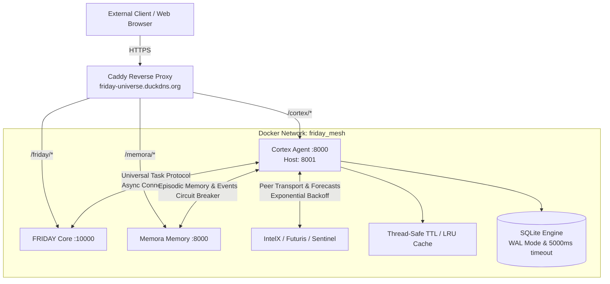

# CORTEX — Autonomous Web Operations Intelligence

> **Role in the FRIDAY Universe:** Cortex is the high-order cognitive reasoning, task decomposition, and logic execution specialist. It ingests, interprets, and acts on structured signals from the web — visitor journeys, conversion patterns, lead scoring, A/B experiments, and security events — decomposing complex operational goals into governed, audited actions.

**Production Gateway:** `https://friday-universe.duckdns.org/cortex/*`  
**Internal Docker Mesh:** `http://cortex:8000` (network: `friday_mesh`)  
**Host Port:** `8001` | **Container Port:** `8000`

---

## Topology & Architecture



All inter-agent calls use Docker internal DNS (`http://friday:10000`, `http://memora:8000`, etc.) within the private `friday_mesh` network. Public URLs are strictly prohibited inside the mesh.

---

## API Specification

### Authentication

All operator endpoints require a JWT Bearer token or the `X-Cortex-Api-Key` / `X-Friday-Api-Key` header.  
Public ingestion endpoints accept a provisioned site API key (`X-Api-Key`).

### Standardized Error Envelope

All API errors return a consistent, structured envelope:

```json
{
  "error": "HTTP_400_BAD_REQUEST",
  "message": "Field 'goal' is required",
  "detail": "Field 'goal' is required",
  "success": false
}
```

### Core Probes & Diagnostics

#### `GET /health`
Liveness probe. Used by Docker `HEALTHCHECK` and edge reverse proxies.

```bash
curl https://friday-universe.duckdns.org/cortex/health
```
```json
{
  "status": "healthy",
  "service": "cortex",
  "version": "2.1.0",
  "evidence_class": "process_liveness",
  "observed_at": "2026-10-14T16:00:00.000000+00:00"
}
```

#### `GET /ready` (or `GET /health/ready`)
Readiness probe. Verifies database connectivity and essential dependency health.

```bash
curl https://friday-universe.duckdns.org/cortex/ready
```
```json
{
  "status": "ready",
  "service": "cortex",
  "database": "connected",
  "observed_at": "2026-10-14T16:00:00.000000+00:00"
}
```

#### `GET /status`
Operational status, active queues, and thread pool metrics.