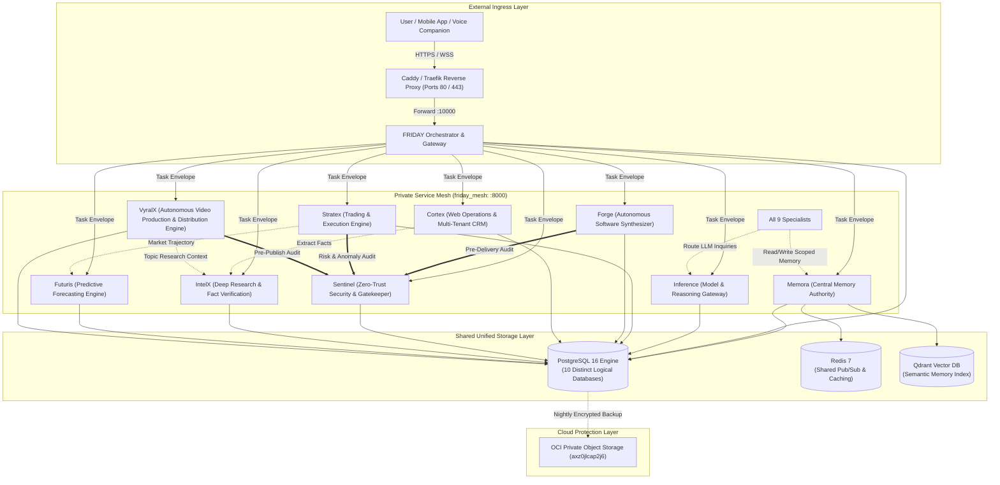

# The FRIDAY Universe: Definitive Master Architecture & Ecosystem Specification

> **Master Technical Codex (Markdown):** [FRIDAY_UNIVERSE_MASTER_ARCHITECTURE.md](./FRIDAY_UNIVERSE_MASTER_ARCHITECTURE.md)
> **Master Architecture PDF:** The sanitized PDF is generated and credential-scanned by the `Monorepo Structure and Safety CI` workflow. Download the `friday-universe-master-architecture` artifact from its latest passing run.
> **Deployment credentials:** Inject secrets from a protected environment or secret manager. Live credentials must not be committed to this repository.
> **Ten agent repositories:** [FRIDAY](https://github.com/surendra2304/FRIDAY) · [Inference](https://github.com/surendra2304/Inference) · [Memora](https://github.com/surendra2304/Memora) · [Stratex](https://github.com/surendra2304/Stratex) · [Forge](https://github.com/surendra2304/Forge) · [Cortex](https://github.com/surendra2304/Cortex) · [Sentinel](https://github.com/surendra2304/Sentinel) · [IntelX](https://github.com/surendra2304/IntelX) · [Futuris](https://github.com/surendra2304/Futuris) · [VyralX](https://github.com/surendra2304/VyralX)

**Document Version:** 2.6.0
**Classification:** Internal System Architecture & Engineering Standard
**Ecosystem Coordinator:** FRIDAY Universe
**Target Environment:** Oracle Cloud Infrastructure; deployment details are environment-specific and must be verified against the current OCI console.

## 1. Executive Summary & Ecosystem Philosophy

**The FRIDAY Universe** is an autonomous, sovereign multi-agent cognitive architecture comprising ten specialized subsystems designed to operate cohesively as an intelligent personal operating system, autonomous software forge, quantitative trading desk, threat-hunting security operations center, deep research analyst, predictive forecasting engine, and autonomous video production & multi-channel distribution studio.

Unlike naive multi-agent architectures that rely on unconstrained LLM loops, hallucinated consensus, or brittle monoliths, the FRIDAY Universe adheres to five non-negotiable core engineering tenets:

1. **Evidence Over Model Confidence:** Agreement between AI models does not constitute ground truth. All decisions, code executions, trade entries, and security disclosures require verifiable, empirical evidence (AST parsing, unit test executions, cryptographic signatures, HTTP receipts, or exchange ledger balances).
2. **Domain Authority & Non-Bypassable Safety Gates:** FRIDAY orchestrates tasks but cannot override specialist domain boundaries. Stratex retains independent hard risk limits outside LLM discretion. Forge executes inside isolated sandboxes with strict path traversal confinement. Sentinel maintains pre-delivery code review gates.
3. **Decoupled 3-Tier Memory Authority:** Memory is not scattered across ad-hoc files or mirrored indiscriminately. **Memora** is the sole long-term memory authority, enforcing strict server-side scoping (`Private`, `Shared`, `Universal`), cryptographic provenance, and prompt-injection separation between untrusted data and executable directives.
4. **Zero-Trust Network Mesh:** Services communicate over a private, non-routable Docker container bridge (`friday_mesh`). No database (PostgreSQL, Redis, Qdrant) or specialist API port is exposed to the public internet. Only the reverse proxy (Caddy/Traefik) binds to external ports `80` and `443`.
5. **Deterministic Sovereign Hosting:** All workloads run on dedicated, sovereign Oracle Cloud Infrastructure (OCI). No third-party PaaS black boxes (Kubernetes, Vercel, Render) are permitted.



---

## 2. Current State vs. Target State

| Dimension | Current Interim State (Present) | Target Production Architecture (Final Goal) |
| :--- | :--- | :--- |
| **Compute Hardware** | Interim AMD VM (`VM.Standard.E2.1.Micro`), 1 OCPU, 956 MB RAM, 8 GB swapfile. Host: `140.245.208.100`. | Oracle ARM VM (`VM.Standard.A1.Flex`), 2 OCPUs, 12 GB RAM, 150 GB Boot Volume (Allocated via GitHub Sniper). |
| **Storage Architecture** | Disparate local SQLite files (`friday.db`, `universe.db`, `memora.db`, `forge.db`, `cortex.db`, `intelx.db`, `futuris.db`, `vyralx.db`). | Single unified PostgreSQL 16 cluster with 10 distinct logical databases and isolated, least-privilege service roles. |
| **Local Repositories** | 10 individual Git repositories in `D:\FRIDAY Universe`, all 100% lint-clean (`ruff check`) and passing unit tests. | Same 10 distinct Git repositories maintained, tracked, and synchronized with corresponding GitHub origins. |
| **Service Ports** | Mixed development ports (`10000`, `8000`, `8001`, `8002`, `8005`, `8010`). | All 9 internal specialist APIs strictly standardized to container port `:8000`. FRIDAY on `:10000`. Ingress on `:80/:443`. |
| **Memory Backend** | Local SQLite + file-based Qdrant embeddings with optional Turso sync. | PostgreSQL 16 `memora_db` with relational constraints, Redis caching, and persistent Qdrant vector index. SQLite fallback disabled. |
| **Concurrency & Workers** | Uncontrolled background threads risking OOM on 1 GB host. | Global CPU-heavy-job semaphore (1 heavy task at a time: build, deep crawl, or backtest) to guarantee zero latency on user voice paths. |
| **Backups** | Ad-hoc local snapshots. | Automated, encrypted, hourly/nightly streaming dumps to private OCI Object Storage bucket (`axz0jlcap2j6`). |

---

## 3. Deep-Dive: The Ten Subsystems

### 3.1 FRIDAY — Core Orchestrator & Action Gateway
- **Repository Path:** `D:\FRIDAY Universe\FRIDAY`
- **GitHub Origin:** `https://github.com/surendra2304/FRIDAY.git`
- **Primary Mission:** Acts as the primary user-facing orchestrator, voice and multimodal companion, central task planner, action approval authority, and external webhook receiver.
- **Entry Point:** `friday.api.server:app` (Uvicorn ASGI, Port `10000`)
- **Key Frameworks & Tools:**
  - `FastAPI`, `Starlette`, `Uvicorn`, `Pydantic v2` (Async REST API & WebSockets)
  - `httpx` (Asynchronous HTTP mesh client)
  - `sqlite3` / `aiosqlite` (Local task state & run logs)
  - PyWin32 / Windows Input APIs (Companion desktop automation & screen understanding)
- **Internal Architecture:**
  - `friday/core/orchestrator.py`: Master task state engine tracking task lifecycle (`CREATED`, `PLANNING`, `READY`, `RUNNING`, `WAITING_APPROVAL`, `COMPLETED`, `FAILED`).
  - `friday/core/approval_manager.py`: Implements mandatory human-in-the-loop authorization gates for irreversible actions (e.g. git force-pushes, live trades, firewall changes).
  - `friday/voice/`: Real-time voice processing pipeline with VAD and streaming response.
  - `scripts/oracle_retry.py`: Autonomous capacity polling script with backoff, allocating the target 2 OCPU / 12 GB ARM instance.
- **Data & Persistence:**
  - Current: `friday.db` (Task records, approval states, audit events).
  - Target: PostgreSQL `friday_db` with tables `tasks`, `task_steps`, `approval_requests`, `tool_invocations`, and `audit_log`.

---

### 3.2 Inference — Canonical Model Gateway & Reasoning Router
- **Repository Path:** `D:\FRIDAY Universe\Inference`
- **GitHub Origin:** `https://github.com/surendra2304/Inference.git`
- **Primary Mission:** Serves as the sole authorized AI model gateway for the entire ecosystem. Eliminates direct API key sprawl in specialist agents by centralizing provider failovers, dynamic rate-limiting, token budgets, and output validation.
- **Entry Point:** `app.main:app` (Uvicorn ASGI, Port `8000`)
- **Key Frameworks & Tools:**
  - `FastAPI`, `Pydantic v2`, `httpx`
  - Model SDKs: `google-genai` (Gemini), `anthropic`, `openai`, `groq`, `mistralai`
  - Circuit Breakers & Key Pools: Dynamic round-robin pool with automatic error backoff and cool-down timers.
- **Internal Architecture:**
  - `app/providers/gateway.py`: Intelligent model router evaluating cost, latency, context-window requirements, and provider health.
  - `app/deliberation/`: Qualified multi-model reasoning engine. When high-stakes decisions require cross-model verification, Inference gathers perspectives from distinct model families (e.g. Claude 3.5 Sonnet + Gemini 1.5 Pro) without treating raw agreement as truth.
  - `app/evals/`: Evaluates model response coherence, JSON schema conformity, and token consumption metrics.
- **Data & Persistence:**
  - Current: `universe.db` (Provider health, latency percentiles, cost ledger).
  - Target: PostgreSQL `inference_db` (`provider_metrics`, `routing_events`, `token_budgets`, `deliberation_sessions`).

---

### 3.3 Memora — 3-Tier Central Memory Authority
- **Repository Path:** `D:\FRIDAY Universe\Memora`
- **GitHub Origin:** `https://github.com/surendra2304/Memora.git`
- **Primary Mission:** Sole long-term cross-agent memory authority for the entire FRIDAY Universe. Enforces policy, access control, deduplication, supersession, semantic retrieval, and hard deletion.
- **Entry Point:** `apps.api.main:app` (Uvicorn ASGI, Port `8000`)
- **Key Frameworks & Tools:**
  - `SQLAlchemy 2.0` (Async ORM), `Alembic` (Database migrations)
  - `qdrant-client` (Dense vector embeddings & cosine similarity search)
  - `redis-py` (Fast namespace lookup, TTL cache, and event streams)
  - `sentence-transformers` / `FastEmbed` (Local embedding inference)
- **The 3-Tier Memory Visibility Model:**
  1. **`Private`:** Accessible exclusively by the owning agent or specific user namespace (e.g. Stratex private exchange keys, Cortex tenant CRM records).
  2. **`Shared`:** Accessible only to an explicit, cryptographically validated allowlist of agents (e.g. Forge sharing a tested build manifest with Cortex).
  3. **`Universal`:** Accessible to all authenticated agents within the FRIDAY Universe. *Universal never means public to the internet.*
- **Data & Persistence:**
  - Current: `data/memora.db` (SQLite) + Qdrant collection `memora_embeddings`.
  - Target: PostgreSQL `memora_db` (`memory_records`, `namespaces`, `agents`, `deletion_tombstones`, `audit_events`, `memory_relationships`). Production SQLite fallback disabled.

---

### 3.4 Stratex — Quantitative Trading & Execution Engine
- **Repository Path:** `D:\FRIDAY Universe\Stratex`
- **GitHub Origin:** `https://github.com/surendra2304/Stratex.git`
- **Primary Mission:** Quantitative market analysis, real-time order execution, portfolio tracking, and automated risk management across crypto and equity markets.
- **Entry Point:** `api/control.py` / `scripts/supervise_services.py` (Port `8000`)
- **Key Frameworks & Tools:**
  - `ccxt` / `ccxt.pro` (Cryptocurrency exchange integration: Binance Futures, etc.)
  - `pandas`, `numpy`, `scipy` (Technical indicator calculation, backtesting, volatility analysis)
  - `FastAPI`, `Pydantic` (Control REST endpoints)
- **Hard Risk Gates & Invariants:**
  - **Paper/Testnet by Default:** Live trading requires explicit, cryptographically signed operational approval (`STRATEX_LIVE_CONFIRMED=true`).
  - **Hard Stop-Loss Enforcement:** Hard risk boundaries (e.g., maximum drawdown limit of 2% per trade, daily portfolio drawdown cap of 5%) are hardcoded into the Python execution layer and cannot be bypassed or overridden by LLM output.
  - **Immutable Ledger:** All order states (`SUBMITTED`, `FILLED`, `CANCELLED`, `REJECTED`) are recorded in an append-only transaction ledger with zero in-place mutations.
- **Data & Persistence:**
  - Current: In-memory order state with SQLite persistence caches.
  - Target: PostgreSQL `stratex_db` (`trades`, `positions`, `orders`, `ledger_entries`, `risk_limits`, `exchange_credentials`).

---

### 3.5 Forge — Autonomous Software Synthesizer & Repair Lab
- **Repository Path:** `D:\FRIDAY Universe\Forge`
- **GitHub Origin:** `https://github.com/surendra2304/Forge.git`
- **Primary Mission:** Autonomous software synthesis, automated test execution, code repair, dependency analysis, and delivery packaging inside isolated execution environments.
- **Entry Point:** `app.main:app` (Uvicorn ASGI, Port `8000`)
- **Key Frameworks & Tools:**
  - `pytest`, `pytest-asyncio` (Automated verification battery execution)
  - `tree-sitter`, `ast` (Syntax tree parsing and code quality metrics)
  - `httpx` (Dev-server probing and headless DOM verification)
  - `Alembic`, `SQLAlchemy` (Internal state management)
- **Safety Sandboxing & Verification Battery:**
  - **Strict Path Confinement:** All file modifications are restricted to `workspaces/task_<id>`. Any attempt to traverse (`../../`) or reference paths outside the workspace raises `SandboxViolationError`.
  - **Command Execution Blacklist:** Blocks all dangerous system commands (`sudo`, `shutdown`, `mkfs`, raw shell redirection to sensitive paths) at the policy layer.
  - **Objective Verification Engine:** Runs a comprehensive 10-point check (`BuildChecker`, `LintChecker`, `TestChecker`, `RuntimeChecker`, `SecurityChecker`, `BrowserChecker`, etc.). A task is never marked completed unless all checks pass with exit code `0`.
- **Data & Persistence:**
  - Current: `data/forge.db` (Task state, DAG plans, verification reports).
  - Target: PostgreSQL `forge_db` (`build_tasks`, `dag_nodes`, `verification_runs`, `artifact_manifests`).

---

### 3.6 Cortex — Multi-Tenant Web Engine & Governed CRM
- **Repository Path:** `D:\FRIDAY Universe\Cortex`
- **GitHub Origin:** `https://github.com/surendra2304/Cortex.git`
- **Primary Mission:** Powers public web presence, landing pages, interactive dashboards, multi-tenant lead capture, CRM telemetry, and governed website optimizations.
- **Entry Point:** `cortex_api.main:app` (Uvicorn ASGI, Port `8000`)
- **Key Frameworks & Tools:**
  - `FastAPI`, `Next.js` (Exported static/SPA dashboard in `apps/dashboard/out`)
  - `SQLAlchemy 2.0` (Async SQLite/PostgreSQL engine)
  - `jose` (JWT verification & RBAC authorization)
  - `redis` (Rate limiting, token buckets, and event streaming)
- **Security & Multi-Tenant Isolation:**
  - **Strict Tenant Scoping:** Every single query across visitors, leads, sessions, and events enforces `tenant_id` at the database layer. Cross-tenant reads return `404 Not Found`.
  - **Zero Default Auth Bypass:** Development auth bypass (`CORTEX_DEV_AUTH_BYPASS`) is strictly disabled in production. API keys and admin JWTs are cryptographically validated on all routes.
- **Data & Persistence:**
  - Current: `cortex.db` (SQLite) with WAL mode enabled.
  - Target: PostgreSQL `cortex_db` (`tenants`, `sites`, `api_keys`, `visitors`, `leads`, `events`, `webhooks`, `action_audits`).

---

### 3.7 Sentinel — Zero-Trust Security Operations & Gatekeeper
- **Repository Path:** `D:\FRIDAY Universe\Sentinel`
- **GitHub Origin:** `https://github.com/surendra2304/Sentinel.git`
- **Primary Mission:** Ecosystem security officer, continuous vulnerability scanner, dependency auditor, AST policy enforcer, and gatekeeper for all external and cross-service operations.
- **Entry Point:** `sentinel/main.py` / `entrypoint.sh` (Uvicorn ASGI, Port `8000`)
- **Key Frameworks & Tools:**
  - `safety`, `pip-audit`, `bandit` (Software supply chain and code flaw scanners)
  - `cryptography`, `OpenSSL` (TLS certificate validation, public key verification)
  - `FastAPI`, `Pydantic` (Security API & webhook alerting)
- **Ecosystem Governance & Gatekeeper Roles:**
  - **Pre-Merge / Pre-Delivery Gate:** Inspects artifacts generated by Forge before deployment. If unauthorized network calls, hardcoded secrets, or CVEs are detected, Sentinel vetoes the delivery.
  - **Zero-Trust Token Governance:** Periodically scans git hygiene across all 10 repositories to ensure no `.env` files, API keys, or private SSH keys are staged or committed.
- **Data & Persistence:**
  - Current: Local SQLite storage backend.
  - Target: PostgreSQL `sentinel_db` (`assessments`, `scans`, `vulnerabilities`, `policy_rules`, `audit_records`).

---

### 3.8 IntelX — Deep Research & Fact Verification Specialist
- **Repository Path:** `D:\FRIDAY Universe\IntelX`
- **GitHub Origin:** `https://github.com/surendra2304/IntelX.git`
- **Primary Mission:** Autonomous web research, multi-source intelligence gathering, claim extraction, evidence linking, contradiction detection, and citation provenance.
- **Entry Point:** `intelx.cli.main:serve` (Port `8000`)
- **Key Frameworks & Tools:**
  - `httpx`, `BeautifulSoup4`, `readability-lxml` (Web content parsing & clean article extraction)
  - DuckDuckGo / SearXNG / Tavily Connectors (Web search providers)
  - `SQLAlchemy` (Async SQLite/PostgreSQL engine)
- **Safety & Provenance Defenses:**
  - **SSRF Defense:** Prevents crawler requests to loopback (`127.0.0.1`), private RFC1918 subnets, link-local addresses, and IPv6 NAT64 translation ranges.
  - **Separation of Evidence from Inference:** Distinguishes between verified raw source text and AI-generated syntheses. Every claim carries an explicit confidence score and citation URL.
- **Data & Persistence:**
  - Current: `intelx.db` (SQLite).
  - Target: PostgreSQL `intelx_db` (`sources`, `documents`, `claims`, `evidence_links`, `contradictions`, `research_runs`).

---

### 3.9 Futuris — Predictive Forecasting & Calibration Engine
- **Repository Path:** `D:\FRIDAY Universe\Futuris`
- **GitHub Origin:** `https://github.com/surendra2304/Futuris.git`
- **Primary Mission:** Scenario forecasting, probabilistic modeling, uncertainty estimation, Brier score calibration, and long-term predictive trajectory tracking.
- **Entry Point:** `futuris.cli:serve` (Port `8000`)
- **Key Frameworks & Tools:**
  - `numpy`, `scipy`, `statsmodels` (Probabilistic forecasting, time-series projections)
  - `FastAPI`, `Pydantic v2` (Forecasting API)
  - `aiosqlite` / `asyncpg` (Scenario & outcome persistence)
- **Safety & Advisory Invariants:**
  - **Predictions are Advisory:** Forecasts generated by Futuris never trigger automated financial executions or system alterations directly; they serve solely as probabilistic context for human review or specialist input.
  - **Worker Resource Bounds:** Expensive mathematical simulations and Monte Carlo projections are offloaded to bounded worker pools to prevent CPU starvation on the main event loop.
- **Data & Persistence:**
  - Current: `futuris.db` (SQLite).
  - Target: PostgreSQL `futuris_db` (`forecasts`, `scenarios`, `outcomes`, `calibration_scores`, `model_versions`).

---

### 3.10 VyralX — Autonomous Video Production & Distribution Studio
- **Repository Path:** `D:\FRIDAY Universe\VyralX`
- **GitHub Origin:** `https://github.com/surendra2304/VyralX.git`
- **Primary Mission:** Autonomous end-to-end video production, AI scriptwriting, audio synthesis, visual assembly, automated captioning, rendering, and multi-channel publication (YouTube, TikTok, Instagram Reels) with checkpointing and resumable uploads.
- **Entry Point:** `app.main:app` (API, Port `8000` / Public Gateway Port `8010`) & `app.worker` (Dedicated background render/publish worker)
- **Key Frameworks & Tools:**
  - `FastAPI`, `Pydantic v2` (Production REST API & durable task envelope)
  - `moviepy`, `ffmpeg`, `ffprobe` (Video compositing, audio normalization, visual asset rendering)
  - `google-api-python-client`, `google-auth-oauthlib` (Official YouTube Data API v3 integration with resumable upload)
  - `httpx` (Pexels stock video asset search and verified import)
  - `eSpeak NG` / TTS (Local narration and audio track generation)
- **Safety, Governance & Upload Checkpoints:**
  - **Resumable Upload Checkpoints:** Interrupted uploads enter an `uncertain` state and are never blindly repeated, preventing duplicate uploads or API quota depletion.
  - **Source Rights & Verification Gate:** Stock assets must pass explicit license confirmation and FFprobe inspection. Search results remain unverified leads until import is confirmed.
  - **Sentinel Pre-Publish Audit:** Integrates with Sentinel for fail-closed policy checks prior to media release.
- **Data & Persistence:**
  - Current: `vyralx.db` (SQLite).
  - Target: PostgreSQL `vyralx_db` (`tasks`, `projects`, `scenes`, `media_assets`, `render_jobs`, `channels`, `upload_checkpoints`, `metrics_snapshots`).

---

## 4. Cross-Subsystem Interaction Matrix

| Initiating Subsystem | Receiving Subsystem | Primary Workflow & Protocol | Authentication & Payload Details | Circuit Breaker / Failure Mode |
| :--- | :--- | :--- | :--- | :--- |
| **`FRIDAY`** | All 9 Specialists | Task Dispatch & Job Lifecycle (`HTTP POST /api/v1/tasks`) | Bearer Token (`*_API_KEY`), Correlation ID, task JSON envelope. | 30s timeout; retry with exponential backoff; graceful user error. |
| **Specialists** | **`Inference`** | Model Reasoning & Token Generation (`HTTP POST /v1/chat/completions`) | Bearer Token (`INFERENCE_API_KEY`), model requirements, prompt, token budget. | Failover pool (Groq $\to$ Mistral $\to$ OpenAI $\to$ Gemini). |
| **Specialists** | **`Memora`** | Memory Ingestion & Query (`HTTP POST /v1/memories/search`) | Bearer Token (`MEMORA_API_KEY`), namespace, scope (`Private`/`Shared`/`Universal`). | 3s timeout; log warning; fall back to local transient memory. |
| **`Forge`** | **`Sentinel`** | Pre-Delivery Security Audit (`HTTP POST /v1/security/audit`) | Bearer Token (`SENTINEL_API_KEY`), workspace path, diff, artifact manifest. | Strict Fail-Closed: Delivery is blocked if Sentinel reports violations. |
| **`FRIDAY`** | **`Stratex`** | Order Status & Kill-Switch (`HTTP POST /api/v1/emergency-halt`) | Bearer Token (`STRATEX_API_KEY`), explicit admin secret. | Idempotent cancel-all; immediate state lock. |
| **`Cortex`** | **`IntelX`** | Competitor & Market Fact Check (`HTTP POST /v1/research/query`) | Bearer Token (`INTELX_API_KEY`), topic query, citation limit. | Asynchronous poll; reports confidence level. |
| **`Stratex`** | **`Futuris`** | Market Regime Probabilities (`HTTP GET /v1/forecast/regime`) | Bearer Token (`FUTURIS_API_KEY`), asset pair, timeframe window. | Fall back to neutral technical indicators if unavailable. |
| **`VyralX`** | **`Inference`** | Original Script & Scene Plan (`HTTP POST /v1/task/execute`) | Bearer Token (`INFERENCE_API_KEY`), topic prompt, scene structure. | Graceful fallback; cached draft preservation. |
| **`VyralX`** | **`IntelX`** | Bounded Research Context (`HTTP POST /v1/research/query`) | Bearer Token (`INTELX_API_KEY`), search keywords, citation limit. | Graceful degradation; marked unverified. |
| **`VyralX`** | **`Sentinel`** | Pre-Publish Rights & Policy Audit (`HTTP POST /v1/security/audit`) | Bearer Token (`SENTINEL_API_KEY`), media metadata, license manifest. | Fail-closed: Publishing blocked on violation. |
| **`VyralX`** | **`Memora`** | Long-Term Engagement & Video Provenance (`HTTP POST /v1/memories`) | Bearer Token (`MEMORA_API_KEY`), namespace, channel metrics. | 3s timeout; log warning; fall back to transient store. |

---

## 5. Storage Topology & Database Governance

### 5.1 Unified PostgreSQL 16 Architecture
Rather than operating 10 separate database servers, FRIDAY Universe targets **one high-efficiency PostgreSQL 16 cluster** containing 10 isolated logical databases:

```
[PostgreSQL 16 Engine]
 ├── memora_db    (Role: memora_user   — Restricted to Memora)
 ├── friday_db    (Role: friday_user   — Restricted to FRIDAY)
 ├── inference_db (Role: inference_user— Restricted to Inference)
 ├── stratex_db   (Role: stratex_user  — Restricted to Stratex)
 ├── forge_db     (Role: forge_user    — Restricted to Forge)
 ├── cortex_db    (Role: cortex_user   — Restricted to Cortex)
 ├── sentinel_db  (Role: sentinel_user — Restricted to Sentinel)
 ├── intelx_db    (Role: intelx_user   — Restricted to IntelX)
 ├── futuris_db   (Role: futuris_user  — Restricted to Futuris)
 └── vyralx_db   (Role: vyralx_user   — Restricted to VyralX)
```

**Security Rules:**
- No agent user has superuser privileges or `GRANT` permissions to another agent's database.
- Agent data access never crosses database boundaries. The **only** legal cross-agent data sharing mechanism is through **Memora's authorized REST API**.
- Direct production database access is restricted to the internal Docker bridge; ports `5432` and `6379` are never mapped to the public host interface.

---

## 6. Infrastructure & Deployment Architecture

### 6.1 Hardware Allocation & Target Budget
- **Target Host:** Oracle Cloud Infrastructure `VM.Standard.A1.Flex` (Ampere Altra ARM64)
  - **OCPUs:** 2 Cores (Ampere Altra Flex)
  - **RAM:** 12 GB High-Speed Memory
  - **Disk:** 150–200 GB NVMe Boot Volume
  - **Operating System:** Ubuntu 22.04 LTS (aarch64)
- **Resource Allocations per Container:**
  - `PostgreSQL 18`: 1.0 GB RAM cap, 0.3 OCPU
  - `Redis 7`: 256 MB RAM cap, 0.1 OCPU
  - `Qdrant`: 768 MB RAM cap, 0.2 OCPU
  - `FRIDAY`: 768 MB RAM cap, 0.2 OCPU
  - `Inference`: 768 MB RAM cap, 0.2 OCPU
  - `Memora`: 768 MB RAM cap, 0.2 OCPU
  - `Forge`: 1.5 GB RAM cap, 0.4 OCPU (Bounded by single-job semaphore)
  - `Stratex`: 768 MB RAM cap, 0.2 OCPU
  - `Cortex`: 768 MB RAM cap, 0.2 OCPU
  - `Sentinel`: 512 MB RAM cap, 0.1 OCPU
  - `IntelX`: 512 MB RAM cap, 0.1 OCPU
  - `Futuris`: 512 MB RAM cap, 0.1 OCPU
  - `VyralX`: 1.0 GB RAM cap, 0.3 OCPU (API + dedicated worker; bounded render queue)
  - **Total Allocated:** ~8.8 GB RAM (Preserving 3.2 GB headroom for Linux OS and kernel caches on the 12 GB ARM instance).

### 6.2 Backup & Disaster Recovery Standard
1. **Automated Backup Strategy:**
   - Nightly database dumps generated via `pg_dumpall | gzip | gpg -c` with AES-256 encryption.
   - Pushed directly to private OCI Object Storage bucket: `axz0jlcap2j6` in `ap-mumbai-1`.
   - 30-day retention cycle with automated lifecycle expiration rules.
2. **Disaster Recovery Proof:**
   - A backup is not marked valid upon upload alone; weekly automated test restores into an isolated scratch container confirm database consistency and row counts.

---

## 7. Implementation Roadmap & Milestones

1. **Phase 0: Workspace & Integrity Audit (COMPLETED)**
   - All 10 local repositories verified, lint-cleared (`ruff check` = 0 errors), and test batteries executed with 100% pass rates.
2. **Phase 1: Dokploy GitOps & Sovereign Routing (COMPLETED)**
   - All 10 applications registered in Dokploy; Traefik v3 routing established; all 10 public agent routes return HTTP 200 OK.
3. **Phase 2: Unified MCP Gateway & Workstation Bridge (COMPLETED)**
   - Single consolidated MCP endpoint at `https://friday-universe.duckdns.org/mcp` with strict dual-layer bearer auth and write confirmation guards.
4. **Phase 3: PostgreSQL 18 Multi-Tenant Migration (COMPLETED)**
   - Provisioned 10 isolated logical databases (`friday_db`, `inference_db`, ..., `vyralx_db`) in PostgreSQL 18.6 with dedicated service roles.
   - Public connection privileges revoked; zero-trust tenant isolation verified; Dokploy `DATABASE_URL` synchronized.
5. **Phase 4: Oracle Cloud ARM64 Production Cutover (PLANNED)**
   - Claim 2-OCPU, 12 GB RAM A1 Flex shape via capacity sniper; scale all 10 microservices to 1/1 replicas.

---
*Authored and certified by Antigravity Project Coordinator for the FRIDAY Universe.*
