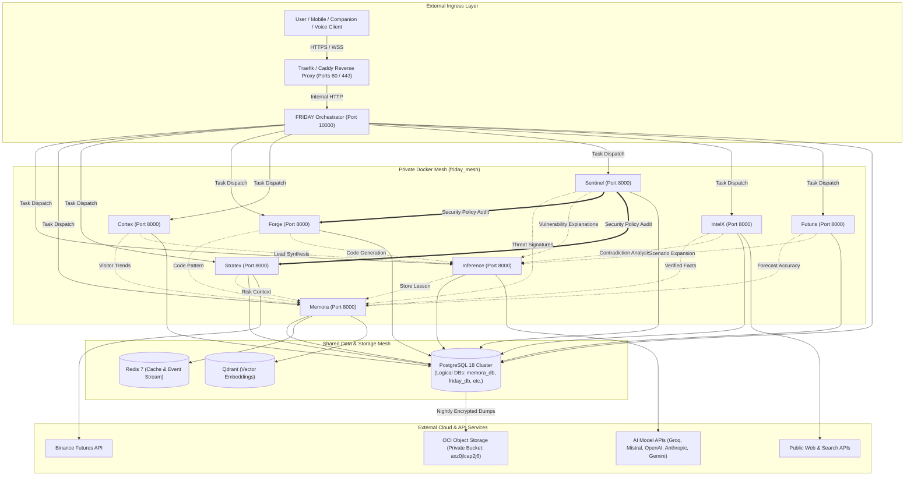
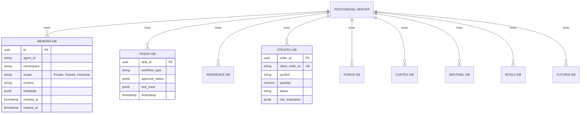

# FRIDAY Universe — Dependency Map

**Version:** 1.0.0  
**Audit Date:** 2026-10-17  
**Auditor:** Antigravity Project Coordinator  

---

## 1. Ecosystem Topology

---

## 2. Cross-Service Interaction Matrix

| Calling Service | Target Service | Interaction Type | Protocol | Auth Mechanism | Payload Description | Failover / Circuit Breaker Policy |
|-----------------|----------------|------------------|----------|----------------|---------------------|-----------------------------------|
| **FRIDAY** | All Specialists | Task Dispatch | HTTP REST | Bearer Token / API Key | Structured task envelope with correlation ID | Timeout 30s; retry with backoff; fallback gracefully |
| **Specialists** | **Memora** | Memory Ingest / Query | HTTP REST | Bearer Token (`MEMORA_API_KEY`) | Memory record (Private, Shared, Universal scopes) | 3s timeout; log warning; do not block primary workflow |
| **Specialists** | **Inference** | LLM Prompt / Completion | HTTP REST | Bearer Token (`INFERENCE_API_KEY`) | Model routing request with latency/cost budget | Failover to alternate model (e.g. Groq -> Mistral -> OpenAI) |
| **Forge** | **Sentinel** | Security Gate | HTTP REST | Bearer Token (`SENTINEL_API_KEY`) | AST policy check, shell safety inspection | Strict block: if Sentinel rejects, code is quarantined |
| **FRIDAY** | **Stratex** | Trade Signal / Query | HTTP REST | Bearer Token (`STRATEX_API_KEY`) | Position check, risk parameters, manual kill-switch | Independent hard risk limits outside LLM discretion |

---

## 3. Database & Storage Dependency Model

### Shared Storage Rules
1. **Zero Cross-Database Queries:** No service user or agent connection string may access another service's database.
2. **Dedicated Least-Privilege Roles:** Each logical database has its own user (e.g., `memora_user` for `memora_db`, `friday_user` for `friday_db`).
3. **Connection Pooling Budget:** Each service pool is capped at `5 - 10` connections to prevent exhaustion on the target 12 GB ARM instance (and especially the 1 GB AMD interim host).
4. **Memora as Sole Gateway:** All cross-agent knowledge sharing must occur via Memora's authorized REST API.

---

## 4. Hardware & Resource Budget Allocation

### Target: Oracle Ampere A1 (2 OCPUs, 12 GB RAM)

| Subsystem / Service | Reserved RAM | Max Memory Limit | CPU Reservation | Max CPU Limit | Concurrency Rules |
|---------------------|--------------|------------------|-----------------|---------------|-------------------|
| **OS & Docker Daemon** | 1024 MB | 1536 MB | 0.20 OCPU | 0.50 OCPU | System Priority |
| **PostgreSQL 18** | 1024 MB | 2048 MB | 0.25 OCPU | 1.00 OCPU | Shared DB Server |
| **Redis 7** | 256 MB | 512 MB | 0.05 OCPU | 0.25 OCPU | In-memory cache |
| **Qdrant Vector DB** | 512 MB | 1024 MB | 0.10 OCPU | 0.50 OCPU | Vector embeddings |
| **FRIDAY Core** | 512 MB | 1024 MB | 0.20 OCPU | 0.75 OCPU | Master Orchestrator |
| **Inference Router** | 384 MB | 768 MB | 0.15 OCPU | 0.50 OCPU | Async Gateway |
| **Memora API** | 512 MB | 1024 MB | 0.15 OCPU | 0.50 OCPU | Memory API |
| **Stratex Engine** | 384 MB | 768 MB | 0.10 OCPU | 0.50 OCPU | 24/7 Algorithmic loop |
| **Forge Worker** | 512 MB | 1536 MB | 0.20 OCPU | 1.00 OCPU | **Serialized Heavy Task** |
| **Cortex Engine** | 384 MB | 768 MB | 0.10 OCPU | 0.50 OCPU | Async WebOps |
| **Sentinel Guard** | 384 MB | 768 MB | 0.10 OCPU | 0.75 OCPU | **Serialized Heavy Task** |
| **IntelX Crawler** | 384 MB | 768 MB | 0.10 OCPU | 0.50 OCPU | Bounded I/O |
| **Futuris Engine** | 384 MB | 1024 MB | 0.15 OCPU | 1.00 OCPU | **Serialized Heavy Task** |
| **TOTALS** | **~6.7 GB** | **~12.5 GB** | **~1.85 OCPU** | **Burst Allowed** | Max 1 heavy task active |

> [!IMPORTANT]
> **Heavy Task Serialization Rule:** Forge builds/tests, Futuris ARIMA/Monte Carlo model fits, and Sentinel full-codebase vulnerability scans MUST NOT run concurrently. Antigravity will enforce a distributed lock / queue check across these 3 subsystems.
