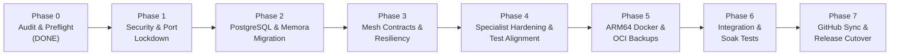

# FRIDAY Universe — Phased Implementation Plan

**Target Host:** Oracle Cloud Infrastructure — ARM64 (`VM.Standard.A1.Flex`, 2 OCPUs, 12 GB RAM)  
**Interim Host:** Oracle Cloud Infrastructure — AMD64 (`VM.Standard.E2.1.Micro`, 1 OCPU, 956 MB RAM)  
**Author:** Antigravity Project Coordinator  
**Execution Strategy:** Safe, reversible, test-driven phases with explicit approval gates before destructive migrations or production cutover.

---

## 1. Roadmap & Phase Summary



---

## 2. Detailed Phase Specifications

### Phase 1 — Critical Security Hardening & Network Isolation
*Objective: Eliminate public port exposure, isolate internal services, and enforce boundary security.*

1. **Host Port Lockdown:**
   - Modify `docker-compose.oracle.yml` to remove host port mappings (`8001:8001` through `8008:8008`).
   - Retain host ingress bindings ONLY for Traefik/Caddy reverse proxy (`80`, `443`) and master FRIDAY gateway (`10000`).
   - Move all 8 specialists to communicate strictly within the internal bridge network `friday_mesh`.
2. **Internal Mesh URL Alignment:**
   - Correct FRIDAY's environment variables in `docker-compose.oracle.yml` and `mesh/config`:
     - `CORTEX_URL=http://cortex:8000` (was `:8001`)
     - `FORGE_URL=http://forge:8000` (was `:8002`)
     - `FUTURIS_URL=http://futuris:8000` (was `:8003`)
     - `INFERENCE_URL=http://inference:8000` (was `:8004`)
     - `INTELX_URL=http://intelx:8000` (was `:8005`)
     - `MEMORA_URL=http://memora:8000` (was `:8006`)
     - `SENTINEL_URL=http://sentinel:8000` (was `:8007`)
     - `STRATEX_URL=http://stratex:8000` (was `:8008`)
3. **Database Port Binding Isolation:**
   - Ensure the PostgreSQL container binds exclusively to internal mesh network or `127.0.0.1:5432`, never `0.0.0.0:5432`.
4. **Stratex Hard Risk Gates:**
   - Verify and reinforce hard stop-loss, max position size, and daily drawdown limits in Stratex code independent of LLM decisions.
5. **Forge Execution Sandbox:**
   - Verify unprivileged container execution; ensure Docker socket is never mounted inside worker execution containers.
6. **IntelX SSRF Defenses:**
   - Restrict outbound crawler requests to public Internet; block loopback (`127.0.0.0/8`), link-local (`169.254.0.0/16`), and private RFC1918 networks.

---

### Phase 2 — PostgreSQL & Memora Enterprise Migration
*Objective: Transition from fragmented SQLite files to a unified PostgreSQL server with 3-tier memory governance.*

1. **PostgreSQL Server & Logical Database Provisioning:**
   - Define a single PostgreSQL 18 service in the mesh with separate logical databases:
     - `memora_db`, `friday_db`, `inference_db`, `stratex_db`, `forge_db`, `cortex_db`, `sentinel_db`, `intelx_db`, `futuris_db`
   - Create distinct least-privilege roles for each agent (e.g. `memora_user` with access only to `memora_db`).
2. **Memora SQLite-to-PostgreSQL Data Migration:**
   - Extract records from `Memora/data/memora.db` (agents, namespaces, memory_records, access_grants, event_logs, audit_logs).
   - Execute Alembic migrations against `memora_db` on PostgreSQL.
   - Load extracted records into PostgreSQL, verifying row counts and foreign key integrity.
3. **Memory Scoping & Authorization Enforcement:**
   - Enforce exact 3-tier visibility scopes server-side:
     - `Private`: Accessible only to the owning agent / namespace.
     - `Shared`: Accessible only to explicit peer agent allowlists in `access_grants`.
     - `Universal`: Accessible to all authorized ecosystem agents (never public internet).
   - Ensure sensitivity, trust level, and TTL remain orthogonal metadata.
4. **Disable Production SQLite Fallback:**
   - Set `USE_SQLITE_FALLBACK="false"` in Memora configuration. Any database connectivity failure must fail-fast and alert rather than silently write to divergent SQLite files.
5. **Reversible Rollback Procedure:**
   - Script automated dump and restore verification before altering any production database configuration.

---

### Phase 3 — Common Internal Mesh Contracts & Resiliency
*Objective: Unify inter-service communication protocols, correlation tracking, and concurrency management.*

1. **Standardized Error & Request Envelopes:**
   - Adopt consistent JSON envelope across all 9 agents:
     ```json
     {
       "status": "success | error",
       "data": { ... },
       "error": { "code": "...", "message": "...", "details": { ... } },
       "metadata": { "task_id": "...", "correlation_id": "...", "timestamp": "..." }
     }
     ```
2. **Distributed Heavy Task Serialization:**
   - Enforce a mutual exclusion rule across resource-intensive operations:
     - Forge builds/test runs
     - Futuris ARIMA/Monte Carlo model fitting
     - Sentinel full-codebase vulnerability scans
   - Only 1 heavy task may run concurrently to protect the VM's CPU and memory budget.
3. **Resilience & Fault Tolerance:**
   - Implement exponential backoff with jitter and per-request timeouts (default: 30s; heavy tasks: 120s with heartbeat).
   - Circuit breakers on all outbound AI provider calls and cross-agent requests.
4. **Health & Readiness Endpoints:**
   - Standardize `/health` (liveness) and `/ready` (dependency checks for DB, Redis, Qdrant) across all agents.

---

### Phase 4 — Specialist Hardening & Test Suite Alignment
*Objective: Harden each domain service and align test suites with canonical package structures.*

1. **FRIDAY Orchestrator Hardening:**
   - Implement hard task budgets (token limits, max tool invocations, max duration).
   - Enforce explicit human approval gates for destructive or external actions.
2. **Inference Gateway:**
   - Implement per-task model routing with cost/latency optimization.
   - Provider fallback chain: Groq -> Mistral -> OpenAI -> Anthropic -> Gemini.
3. **Cortex WebOps:**
   - Strict tenant isolation on all database queries and CRM webhook actions.
4. **Sentinel Gatekeeper:**
   - Validate authorized target scopes and operator authentication before running active scans.
5. **Test Suite Import Alignment:**
   - Update tests in `Forge/tests/`, `Cortex/tests/`, `IntelX/tests/`, and `Memora/tests/` to import canonical packages (`app.*`, `cortex_api.*`, `intelx.*`, `apps.*`) rather than deleted `*_upgrade` folders.
   - Run safe unit tests and achieve 80%+ test pass rate across all suites.

---

### Phase 5 — ARM64 Container Architecture & OCI Backup Pipeline
*Objective: Build production-ready ARM64 containers and establish automated OCI Object Storage backups.*

1. **Multi-Architecture Dockerfiles:**
   - Verify and tune all 9 Dockerfiles for `linux/arm64` (with `linux/amd64` compatibility).
   - Base images: `python:3.11-slim`, `node:20-alpine` (Cortex dashboard).
2. **ARM64 Resource Budget Configuration:**
   - Apply CPU and memory reservations and hard limits in `docker-compose.oracle.yml` (total budget: 2 OCPUs, 12 GB RAM):
     - PostgreSQL: 1 GB reservation, 2 GB limit
     - Redis: 256 MB reservation, 512 MB limit
     - Qdrant: 512 MB reservation, 1 GB limit
     - FRIDAY: 512 MB reservation, 1 GB limit
     - Specialists: 384 MB reservation, 768 MB limit each
3. **Automated OCI Object Storage Backup Service:**
   - Script automated nightly logical backups (`pg_dump` of all 9 databases + Qdrant snapshot).
   - Compress with gzip, calculate SHA-256 checksum manifest.
   - Upload to private OCI Object Storage bucket in namespace `axz0jlcap2j6`.
   - Implement retention cleanup (7 daily, 4 weekly backups).
   - Provide tested one-line disaster recovery restore script.

---

### Phase 6 — Integration, Load & Chaos Testing
*Objective: Validate full ecosystem behavior under realistic operational conditions.*

1. **End-to-End User Flow:**
   - Client -> FRIDAY voice/text -> Inference routing -> Memora recall -> Specialist execution -> Memora storage -> Client response.
2. **Memora Scope Verification:**
   - Verify `Private` memories are inaccessible to peer agents.
   - Verify `Shared` memories are accessible only to allowlisted peers.
   - Verify `Universal` memories are accessible across the ecosystem.
3. **Fault Injection & Chaos Scenarios:**
   - Temporary PostgreSQL disconnect -> verify services fail cleanly without silent SQLite fallback.
   - AI provider rate-limit / outage -> verify seamless fallback to secondary model.
   - Heavy task concurrency test -> verify serialization lock holds.

---

### Phase 7 — GitHub Synchronization & Production Cutover
*Objective: Safely synchronize local work to GitHub and execute zero-downtime release deployment.*

1. **Pre-Push Validation:**
   - Review all Git diffs across the 9 repositories.
   - Run security and secret scans on all modified files.
2. **GitHub Synchronization:**
   - Push verified branches to existing GitHub remotes (`origin/main`).
   - Record exact pushed commit SHAs in the release ledger.
3. **Production Deployment Approval Gate:**
   - Present a concise, exact production change plan with verified backup confirmation and rollback procedures.
   - **Require explicit user approval** before executing database migrations or container cutover.
4. **Deployment & Verification:**
   - Pull updated containers on Oracle Cloud host.
   - Execute database migrations.
   - Verify `/health` and `/ready` status on all 9 agents.
   - Confirm healthy ecosystem operation and issue final release report.
